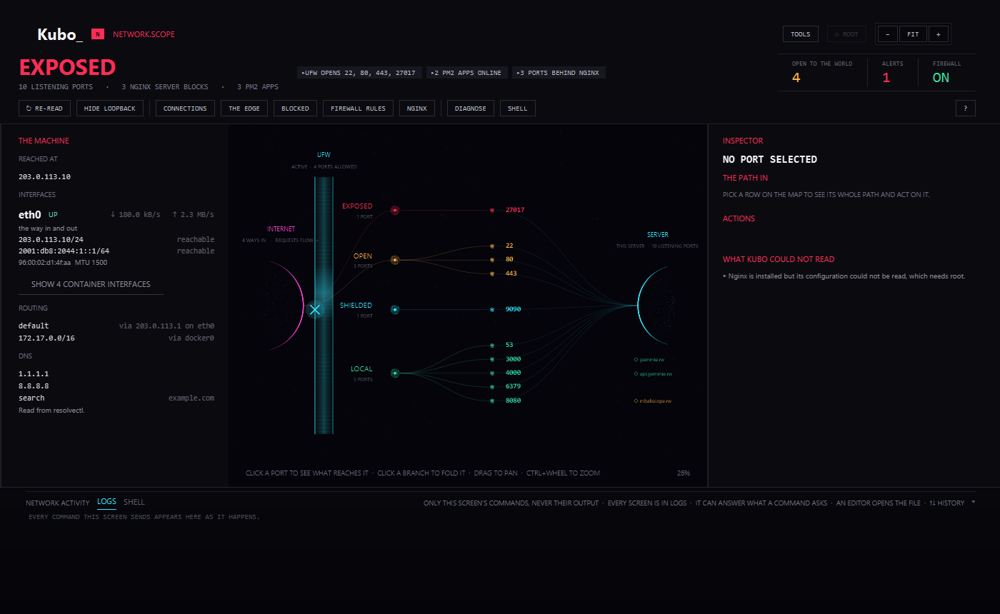
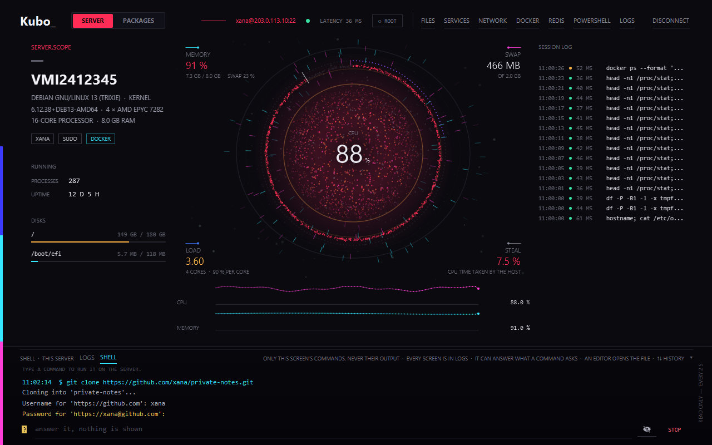
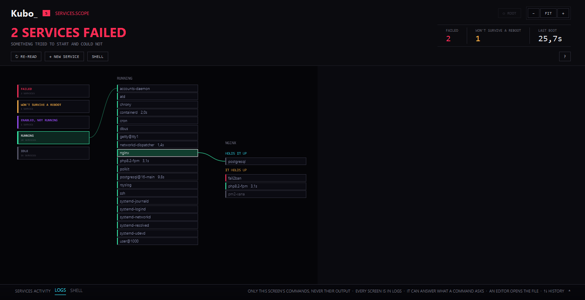
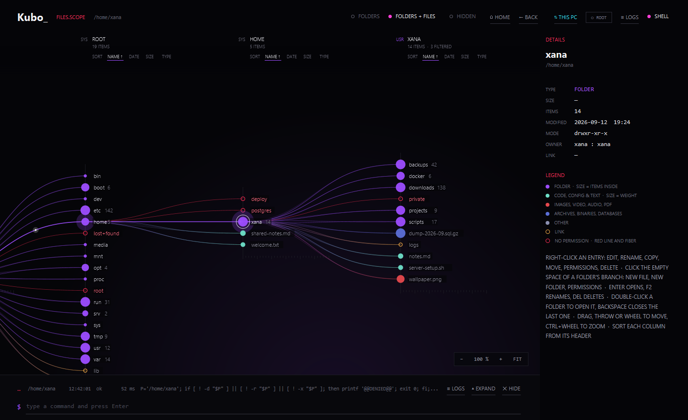
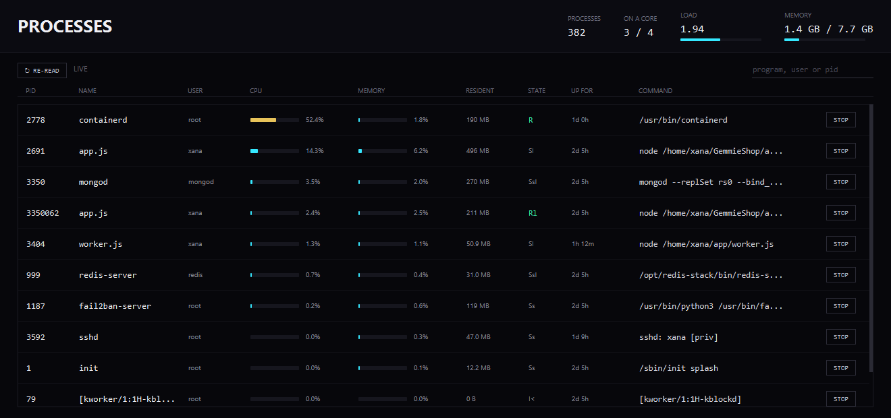

# Kubo

**Kubo is a desktop app that manages a Linux server for you, visually, over SSH.**

You type your server's address once. Kubo connects, reads the machine, and lays it out on screen: how hard it is
working, which ports are open to the internet, what files are on it, which services will survive a reboot, what
Docker is running, what needs updating. Everything you would normally find by typing a dozen commands and
remembering what each one means.

It runs on your own computer, Windows or Linux. The server gets nothing installed on it.

**[⬇ Download Kubo](https://github.com/Lightminedust/Kubo/releases/latest)** · [kubo.gemmi-e.com](https://kubo.gemmi-e.com)
· [Built by Gemmie](https://gemmi-e.com/contact)



*The network screen. The internet on the left, the server on the right, the firewall between them. Each port is
sorted by how far it can really be reached, not by whether something is listening on it.*

> **If you only read one thing:** Kubo has no account, no cloud and no telemetry. It opens exactly one network
> connection, the SSH connection to the server you typed. Everything it saves, it saves on your computer, in files
> you can open and read. [How you can check that for yourself](#how-you-can-check-this-yourself) is further down.

---

## Who this is for

You have a server somewhere. A VPS, a machine in an office, a Raspberry Pi. You can already log into it with SSH
and you get by. But:

- you are never quite sure which ports are **actually** reachable from the internet, as opposed to merely listening
- a service works today and you have no idea whether it will come back after a reboot
- you edit a config with `nano` through a terminal that scrolls away
- you have never read a firewall rule out loud and been certain you understood it
- `df`, `ss`, `systemctl`, `journalctl`, `apt`, `docker stats` are all things you look up every time

Kubo runs those commands for you and draws the answer. You do not have to stop using the terminal. There is one
built into the app, and it logs what it sends.

**You do not need to be a Linux expert.** You do need a server you are allowed to administer.

---

## What Kubo never does

This is the part worth being precise about, because an app that holds SSH access to your server is asking for a
lot of trust.

| | |
| --- | --- |
| **No account** | There is nothing to sign up for. No email, no licence key, no login screen. |
| **No cloud** | Kubo has no backend. There is no server of ours for it to talk to, because there is no "ours". |
| **No telemetry** | Nothing is counted, measured or reported. No crash reports, no usage statistics, no "anonymous" anything. |
| **No update check** | The app never phones home to ask whether it is out of date. You update it when you choose to, by downloading a new version. |
| **No reading your other files** | Kubo opens files on your computer only when you pick them: a key file you choose, a file you drag in to upload, a folder you choose to download into. |
| **Nothing installed on the server** | No agent, no daemon, no package. Kubo sends ordinary shell commands through SSH, the same ones you could type yourself. Uninstalling Kubo leaves the server exactly as it was. |

### The one connection it makes

Kubo opens an SSH connection to the address you typed, with the credentials you gave it. That is the only outbound
connection the app itself makes. Not "the only one we use for analytics". The only one, full stop.

**One honest exception, which is not really an exception.** Some commands you can ask Kubo to run make *the server*
talk to the internet: `apt` downloads packages from your distribution's mirrors, `whois` asks a public registry who
owns an address. That is the server reaching out because you asked it to, exactly as if you had typed the command
yourself in a terminal. Your computer still talks only to your server. Kubo says so on the tools that do this,
before they run.

### How you can check this yourself

You do not have to take any of the above on faith.

1. **Count the libraries.** Kubo is built from three ([`gradle/libs.versions.toml`](gradle/libs.versions.toml)):
   `sshj` for SSH, `jackson` for reading and writing the JSON files on your own disk, and `slf4j-simple` for
   internal logging. There is no HTTP client in the application at all. There is nothing in it that *could* make a
   web request.
2. **Watch the connections.** Run Kubo and look at your own machine's open connections (`netstat`, Resource
   Monitor, Little Snitch, whatever you use). You will see port 22 to your server, and nothing else.
3. **Read the log.** Every command Kubo sends is written to a JSON file on your computer, as it is sent. Open it in
   any text editor. If Kubo ever sent something you did not ask for, it would be in there.
4. **Read the source.** It is in this repository.

---

## What it saves, and where

Three files, all under your home folder, all plain text you can open.

| Path | What is in it |
| --- | --- |
| `.kubo/known_hosts` | The fingerprint of each server you chose to trust |
| `.kubo/sessions.json` | Your saved servers: address, user, which method, path to a key file |
| `.kubo/logs/*.json` | One file per session: every command, when, from which screen, exit code, how long it took |

On Windows that is `%USERPROFILE%\.kubo`. On Linux, `~/.kubo`. Delete the folder and Kubo has forgotten
everything.

### About the log

The log is the heart of the thing, so it is worth saying exactly what is in it.

**It records every command Kubo sends.** Not a summary, not the interesting ones. Every one, including the ones
Kubo sent on its own to refresh a screen, each marked with which screen asked for it and whether it ran as root.

**It never records output.** Not the contents of a file you opened, not what a command printed, not your data. Only
the size of what came back. A log that captured output would be a copy of your server's secrets sitting on your
laptop, and the point of the log is to be safe to keep.

**You can read it inside the app.** The **LOGS** screen lists every session, filters by screen or by failures, and
exports to JSON. You can also just open the files.

### About passwords

A password, a key passphrase or a sudo password is held in memory as a character array and wiped as soon as it has
been used. It is written to disk **only if you tick "remember"**, and then:

- **On Windows**, encrypted with DPAPI, which ties it to your Windows account. Another account on the same
  computer cannot read it.
- **On Linux**, not at all. There is no equivalent that every Linux machine is guaranteed to have, so Kubo saves
  nothing rather than writing a secret somewhere it could be read. The path to a key file is still remembered.

A sudo password is never written to disk on any system.

---

## Install it

Download from **[the releases page](https://github.com/Lightminedust/Kubo/releases/latest)**. Every package contains
the same application and brings its own Java, so there is nothing to install first.

**Windows 10 or 11**

| | |
| --- | --- |
| **Installer** | `Kubo-Setup.exe`. The usual way. Start menu entry, and a new version replaces the old one instead of sitting beside it. |
| **Portable** | `Kubo-windows-portable.zip`. Unzip anywhere, run `Kubo.exe`. No administrator rights, nothing written to the registry. Delete the folder and it is gone. |

The installer is not code-signed yet, so Windows may call the publisher unknown. **More info → Run anyway**.

**Linux desktop.** x86-64, needs a graphical session and GTK 3, which every mainstream desktop already has.

| | |
| --- | --- |
| **Debian, Ubuntu, Mint** | `sudo apt install ./kubo_1.3.0_amd64.deb` |
| **Fedora, RHEL, Rocky, Alma, openSUSE** | `sudo dnf install ./kubo-1.3.0-1.x86_64.rpm` |
| **Anything else** | `tar -xzf Kubo-linux-x86_64.tar.gz && ./Kubo/bin/Kubo` |

Note that Kubo *manages* Linux servers. It does not run on one as a server; it is a desktop app.

---

## What you can do with it

### The machine



Operating system, kernel, processor, memory, swap, load, disks, and what is running. It updates while you watch.
The console along the bottom is in every screen: it shows the commands that screen is sending, as it sends them.

### Services



A service can be running right now and still not be enabled at boot. It works until the next restart, then it is
gone, and nothing tells you. Kubo checks both states for every service and sorts them by that: failed, won't
survive a reboot, enabled but stopped, running, idle.

Pick one to see what it depends on and what depends on it. Start, stop, enable, disable, set a memory or processor
limit, read its journal, turn a script into a service. Kubo refuses to stop SSH or the network, because you would
lose the server.

### Files



Browse the whole filesystem. Open and edit a text file, rename, copy, move, change permissions with the words
spelled out, download, delete. Drag files from your computer to upload them. A **ROOT** button unlocks the folders
that belong to root, so you can edit a config in `/etc` or drop a file into `/var/www`.

### The shell, and what it does instead of drawing



There is a terminal on the server, in the app, and every command it sends goes to the log. It can answer what a
command asks: a password for `git clone`, a passphrase for `ssh-keygen`, a `[y/N]`.

Some programs draw a screen rather than print lines: they move the cursor around, colour cells and repaint in
place. A console that shows lines of text can only show the instructions. So Kubo answers those with the thing
they were for:

| You type | What happens |
| --- | --- |
| `nano /etc/hosts` | The file opens in Kubo's editor |
| `htop`, `top`, `ps aux` | The process table above, refreshed every three seconds, with a stop button per row |
| `pm2 list` | The same, for pm2, with restart and stop per row |
| `pm2 logs`, `tail -f`, `journalctl -f` | The log opens in its own window and keeps filling while you work elsewhere, with errors in red and a filter |

### The rest

| Screen | What it is for |
| --- | --- |
| **Connection** | Add a server with a password or a private key (OpenSSH, PEM or PuTTY `.ppk`). The first time, Kubo shows the server's fingerprint and asks whether you trust it. |
| **Network** | Which ports are listening, and for each one whether it is really reachable from the internet, blocked, or local only. Kubo reads your firewall (UFW, firewalld, nftables or iptables) and compares. It names the program, PM2 app or Docker container behind each port. Open and close ports, switch the firewall on and off. Nginx has its own screen that draws how a request reaches each site and turns red at the step that breaks. A separate screen lists every address fail2ban and the firewall have shut out. |
| **Packages** | What is installed and what is waiting to be updated, security updates first. Every install and removal is simulated first and shows what would really change, including anything it would drag out with it. |
| **Docker** | Containers, their state, processor and memory use, ports, volumes. Start, stop, restart, delete, read logs, open a terminal inside a container, browse its filesystem. |
| **Redis** | Keys by type, editing a hash or list or set as JSON, memory use, slow queries, a live monitor and a Redis console. It never runs `KEYS *` on your database. |
| **Logs** | Every session, every command, filterable and exportable. |

Everything is read-only until you act. Anything that changes the server asks first, and anything destructive asks
you to type the name of what you are about to destroy.

---

## How it actually works

There is no magic and no agent. When Kubo shows you the disks, it ran `df`. When it shows you the open ports, it
ran `ss`. It parses the answer and draws it.

That has three consequences worth knowing:

1. **It works on a server you did not prepare.** Any mainstream Linux distribution with an SSH account.
2. **It can only see what your account can see.** A non-root account cannot read firewall rules. Kubo then says
   "the firewall is running, I cannot read its rules" rather than pretending nothing is filtered. It never counts
   an unreadable firewall as protection.
3. **Root is yours to give.** Kubo never becomes root on its own. The **ROOT** button asks for your sudo password
   once per session; while root is on, every window's wordmark reads `Kubo_root` so it is never a surprise.
   Leaving root mode, or disconnecting, wipes the password immediately.

### The rules the code follows

- **Commands that need root are fixed templates.** They are never assembled out of something you typed. Where a
  command does need a value from you, the value is checked against a strict pattern and then quoted; file contents
  go in through the command's input, never into the command line.
- **Everything is quoted.** Every path and name is quoted before it reaches the shell.
- **A changed host key is refused.** Not warned about. Refused. A key that changed is either a reinstalled server
  or somebody standing between you and it, and Kubo cannot tell which.
- **Writes are atomic.** Uploads, downloads and file saves land in a temporary file and take their real name only
  once they are complete. A cancelled or broken transfer leaves nothing half written.
- **A Redis password never appears on a command line**, where any user on the server could read it with `ps`. It
  is sent on the command's standard input and read from there into an environment variable that `redis-cli` picks
  up by itself.

---

## Requirements

| | |
| --- | --- |
| **Your computer** | Windows 10 or 11, or an x86-64 Linux desktop with GTK 3. The packaged app brings its own Java. Building from source needs JDK 21. |
| **The server** | Any mainstream Linux: Debian, Ubuntu, RHEL, Rocky, Alma, Fedora, Arch, openSUSE. The **Packages** screen needs apt and dpkg, so it is Debian family only; every other screen works anywhere. |
| **Access** | An SSH account, with a password or a private key. |

The file manager needs the GNU versions of the usual tools (coreutils, findutils, GNU `tar`) and `/proc`. Every
distribution above has them. Kubo checks when the file manager opens and tells you if something is missing rather
than failing halfway through a transfer.

**Not supported as servers:** BusyBox systems such as Alpine without coreutils, most routers and NAS boxes, BSD,
macOS.

---

## Build it yourself

```powershell
.\gradlew.bat run                             # run Kubo from the sources
.\gradlew.bat jpackage                        # a plain folder with its own Java runtime
.\gradlew.bat portable                        # Kubo-windows-portable.zip
.\gradlew.bat jpackage -PinstallerType=exe    # the installer offered on the site
.\gradlew.bat jpackage -PinstallerType=msi    # the installer winget runs
```

```bash
./gradlew tarball                             # Kubo-linux-x86_64.tar.gz
./gradlew jpackage -PinstallerType=deb        # Debian, Ubuntu and derivatives
./gradlew jpackage -PinstallerType=rpm        # Fedora, RHEL, Rocky, Alma, openSUSE
```

`jpackage` cannot build for a system other than the one it runs on. The Windows installers need Windows with the
WiX Toolset v3 on the PATH; the Linux ones need Linux with `fakeroot`, `binutils`, `dpkg-dev` and `rpm`. CI builds
both on a tag. Add `-PappVersion=1.3.0` to stamp a version.

### Tests

```powershell
.\gradlew.bat test                 # unit tests
.\gradlew.bat integrationTest      # real SSH round trips against a server started inside the tests
.\gradlew.bat check                # both, plus the coverage rule: 70 % of lines outside the UI
.\gradlew.bat jacocoTestReport     # coverage report in app/build/reports/jacoco
```

The integration tests are not mocks. They start an Apache MINA SSHD server in the test process and talk to it over
a real SSH connection.

The screens are checked by rendering them. `previewScope`, `previewFiles`, `previewNetwork`, `previewServices`,
`previewDocker`, `previewRedis`, `previewPackages`, `previewShell` and `previewConnection` draw every state with
sample data and no server, into `app/build/previews`. The pictures in this file came out of those tasks.

### Where things are

| Package | What is in it |
| --- | --- |
| `connection`, `connection.ssh` | SSH transport, host key trust, saved sessions, secret protection |
| `command` | One command and its result; the history of a session |
| `logs` | Writing and reading the session logs |
| `monitor`, `monitor.parse` | Polling the machine, and reading the answers |
| `files` | File commands, uploads and downloads |
| `network` | Reading `ss`, the firewalls, PM2 and Nginx, and cross-referencing them |
| `services` | systemd units, their boot state and their dependencies |
| `packages` | apt and dpkg, each change simulated before it runs |
| `docker`, `redis` | Those two, over SSH |
| `privilege` | Root through sudo, always after asking |
| `model` | Plain records with no behaviour: servers, files, permissions, processes |
| `ui.*` | The JavaFX screens. Drawing is on canvases and kept apart from state. |

Continuous integration runs `check` on both Windows and Linux for every push, and builds the packages on a tag.

---

## Licence and contact

Kubo is the intellectual property of **Gemmie**. Built and maintained by Awassi Nell Damas, in Kigali.

| | |
| --- | --- |
| **Download** | [github.com/Lightminedust/Kubo/releases](https://github.com/Lightminedust/Kubo/releases/latest) |
| **Website** | [kubo.gemmi-e.com](https://kubo.gemmi-e.com) |
| **Bugs and requests** | [open an issue](https://github.com/Lightminedust/Kubo/issues) |
| **Portfolio, and work enquiries** | [gemmi-e.com/contact](https://gemmi-e.com/contact) |
| **Email** | [nellawassi@gmail.com](mailto:nellawassi@gmail.com) |

If Kubo is useful to you, a star on the [release repository](https://github.com/Lightminedust/Kubo) helps more than
you would think.
